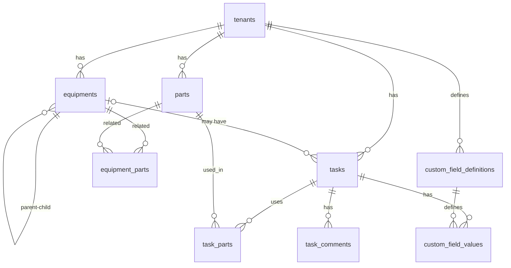

# M2X課題 — 工場向けタスク管理システム データベース設計

エンタープライズ製造業・インフラ施設向けのタスク管理・設備保全SaaSを想定したPostgreSQLデータベーススキーマ設計です。初期のMVP要件を満たすだけでなく、将来的なデータ量増加（数億レコード規模）や高トラフィック、およびB2B SaaS特有の厳しいセキュリティ要求に耐えうるアーキテクチャを目指しました。

---

## 課題2: 追加機能の提案 — 「タスクコメント機能」

課題要件に基づき、任意の追加機能として「タスクコメント機能」を提案・設計しました。（対応テーブル: `task_comments`）

工場の現場では、一つのタスク（例: 設備の修理や点検）が複数のシフトや担当者をまたいで行われるケースが多々あります。本機能により、以下のような現場のペインを解決します。

* 作業履歴の時系列記録: 「誰が・いつ・どのような対応をしたか（例: 部品の発注待ち等）」を正確に追跡できる。
* 担当者間の情報共有: シフト交代時の引き継ぎをシステム上でスムーズに行える。
* 問題分析の支援: タスク完了後も当時のコメントを参照することで、再発防止策の検討に活用できる。

---

## システムアーキテクチャと主要な設計方針

### 1. マルチテナント対応とセキュリティ（論理分離 × RLS）
本システムは全テーブルに `tenant_id` を保持する「論理分離方式」を採用しています。
さらに、アプリケーション層の実装ミスによる「他テナントデータの漏洩」をデータベースレベルで物理的に防ぐため、PostgreSQLの Row-Level Security (RLS) を主要テーブルに適用しています。

### 2. テナント独自入力項目（EAVパターンの採用）
課題の要件である「テナントごとに独自のタスク入力項目（Cause of stoppage等）を設定・作成できる機能」を実現するため、EAV（Entity-Attribute-Value）パターンを採用しました。

* `custom_field_definitions` (Attribute): テナントが定義する項目のメタデータ（型、必須フラグ、選択肢など）
* `custom_field_values` (Value): 各タスクに紐づく実際の入力値

【トレードオフと代替案の検討】
JSONBカラムを使用するアプローチも検討しましたが、本要件では「将来的な個別項目ごとの集計・検索」や「厳密な型バリデーション」が求められると判断し、RDBの強みを活かせるEAVモデルを選択しています。パフォーマンス懸念に対しては、ピボットクエリや適切なインデックス設計で対応します。

### 3. 設備の階層構造（自己参照外部キー）
画面仕様の「Parent Equipment」に対応するため、`equipments` テーブル内に `parent_equipment_id` を設け、自己参照による階層構造（Adjacency List）を表現しています。データの取得には再帰CTE（`WITH RECURSIVE`）を使用します。

---

## エンタープライズスケールへの最適化（高度なリファクタリング）

SaaSが成長し、数万の設備と数億の計測データ・ログを抱えるフェーズを見据え、初期設計の段階で以下の高度なチューニング（`002_enterprise_refactor.sql`）を組み込んでいます。

#### A. 時系列データのネイティブ・パーティショニング
* 課題: IoTセンサーデータや監査ログ（`audit_logs`）は膨大な追記型データとなり、単一テーブルでは将来的に検索性能の劣化やデータパージ運用が限界を迎えます。
* 解決策: PostgreSQL 10以降の宣言的パーティショニングを採用し、月次パーティション（`PARTITION BY RANGE`）を構築。古いデータのアーカイブやパージが `DROP TABLE` で瞬時に完了する運用容易性を確保しました。時系列検索に特化した `BRIN` インデックスも採用しています。

#### B. 例外処理（EXCEPTION）を排除した高速なEAVバリデーション
* 課題: EAVパターンで値を `NUMERIC` 等にキャストする際、PostgreSQLの `BEGIN ... EXCEPTION` ブロックを使用するとサブトランザクションが発生し、大量データ投入時に深刻なパフォーマンス低下を招きます。
* 解決策: トリガー関数内の例外処理を排除し、正規表現（例: `value !~ '^-?[0-9]+(\.[0-9]+)?$'`）による厳密な事前チェックを実装。堅牢性と高スループットを両立しました。

#### C. 論理削除（Soft Delete）と物理削除の競合解消
* 課題: B2B SaaSではデータ復元要件から論理削除（`deleted_at`）が基本ですが、RDBの `ON DELETE CASCADE` は物理削除にしか反応しないため、親設備を論理削除してもタスクが生き残る「孤児データ」が発生します。
* 解決策: 外部キー制約を `ON DELETE RESTRICT` に変更して物理削除事故を防止。その上で、親の論理削除を検知して子も連鎖的に論理削除する専用トリガー（Soft Delete Cascade）を実装し、完全なデータ整合性を担保しました。

#### D. コネクションプーリング（PgBouncer等）の安全性確保
* 課題: RLS利用時に `SET` でセッション変数を書き換えると、トランザクションプーリング環境において「他テナントへ変数が漏洩する（セッション汚染）」という致命的な脆弱性に繋がります。
* 解決策: 関数内に、アプリケーション層から必ず `SET LOCAL`（トランザクションスコープ）を使用する旨の設計規約を明記し、安全な関数実装を行いました。

---

## 前提条件・仮定事項

課題の仕様から、エンジニアとして以下の仮定を置き設計を行いました。

| # | 仮定内容 | 根拠・設計への反映 |
|---|---|---|
| 1 | マルチテナントは論理分離方式を採用 | 全テーブルに `tenant_id` を保持。運用コストと拡張性のバランスを考慮。 |
| 2 | タスクと設備の紐づけは「任意」 | 課題要件の必須項目にEquipmentが含まれていないため、`equipment_id` はNULL許容とした。 |
| 3 | タスクステータスは固定の3種類 | 画面の「todo」から推定し `ENUM ('todo', 'in_progress', 'done')` と定義。 |
| 4 | タスクに複数部品を使用数量付きで登録可能 | 画面の「Parts Used: Quantity 1」等から推定。中間テーブル `task_parts` に `quantity` カラムを配置。 |
| 5 | コメント投稿者はユーザーテーブルと別管理 | ユーザー管理仕様が不明なため、MVPとして `commented_by (VARCHAR)` で保持。将来的な拡張用にFK追加を想定。 |

---

## テーブル構成とER図

### 主要テーブル一覧
| テーブル | 説明 |
|---|---|
| `tenants` | テナント（工場環境）の管理 |
| `equipments` | 設備マスタ（親子階層対応） |
| `parts` | 部品マスタ（在庫数・発注点管理） |
| `equipment_parts` | 設備 ⇔ 部品の多対多関連 |
| `tasks` | タスク管理 |
| `task_parts` | タスクで使用する部品（数量付き） |
| `custom_field_definitions` | テナント独自のカスタム入力項目定義 |
| `custom_field_values` | カスタムフィールドの値（EAVパターン） |
| `task_comments` | 【課題2】タスクコメント |
| `audit_logs` | （エンタープライズ機能）全変更追跡・不変ログ |

### ER図


---

## ディレクトリ構成

システム進化のプロセス（MVP構築 → エンタープライズスケール化）を表現するため、マイグレーションファイルを段階的に分割しています。

```text
db/
├── migrations/
│   ├── 001_create_tables.sql       # MVPベーススキーマ（課題1, 2, 拡張定義）
│   ├── 002_enterprise_refactor.sql # 大規模運用向けリファクタリング（パーティショニング等）
│   └── 003_seed_data.sql           # 開発体験を考慮した冪等性のあるシードデータ
└── queries/
    └── sample_queries.sql          # 実務レベルの集計クエリ例（37種類）

```

---

## 実行手順 (How to Run)

Docker環境でPostgreSQLを立ち上げ、以下の順にスクリプトを実行してください。

```bash
# 1. DBコンテナの起動
docker compose up -d

# 2. マイグレーションとシードデータの流し込み
cat db/migrations/001_create_tables.sql | docker compose exec -T db psql -U postgres -d m2x_db
cat db/migrations/002_enterprise_refactor.sql | docker compose exec -T db psql -U postgres -d m2x_db
cat db/migrations/003_seed_data.sql | docker compose exec -T db psql -U postgres -d m2x_db

```

> テスト用アカウント情報:
> シードデータで投入される全ユーザー共通のログインパスワードは `password123` です。
> 相対日時(`CURRENT_DATE`等)を使用してデータを生成しているため、いつ実行してもダッシュボード上で現在進行形のリアルなデータとして確認できます。
